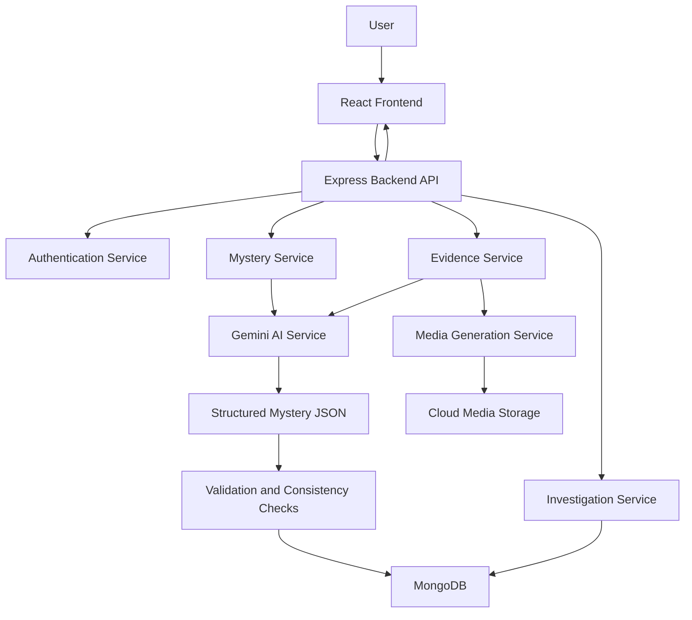

# AI MYSTERY ROOM
## Software Requirements Specification (SRS) & Single Source of Truth

**Version:** 1.0  
**Status:** Initial Development Specification  
**Development Methodology:** Spec-Driven Development (SDD)  
**Frontend:** React.js  
**Backend:** Node.js + Express.js  
**Database:** MongoDB  
**AI Provider:** Google Gemini API  
**Primary Development Agent:** OpenAI Codex

---

# 1. PROJECT OVERVIEW

## 1.1 Project Description

AI Mystery Room is an AI-powered interactive mystery investigation web application where users solve fictional crimes and mysteries by examining evidence, analyzing clues, and identifying the culprit.

The user begins by providing a short scenario, story idea, or mystery premise. The application uses Google Gemini AI to transform this input into a complete fictional investigation.

The generated investigation contains:

- A fictional crime or mysterious incident.
- A set of suspects, each with a unique background and motive.
- A hidden culprit selected by the AI.
- Evidence such as WhatsApp-style conversations, images, CCTV recordings, documents, and witness statements.
- A logical sequence of clues that allows the user to solve the mystery.
- A final accusation interface where the user selects the culprit.

The AI must generate a coherent investigation in which the culprit is determined before the user begins investigating.

The user must solve the case using the evidence provided. The application must not reveal the culprit until the user submits their final accusation or explicitly requests the solution after the appropriate game state.

## 1.2 Core Concept

The complete experience follows this flow:

1. The user submits a scenario or story premise.
2. The backend validates the submission and sends it to Gemini.
3. Gemini generates a complete fictional mystery investigation, including one predetermined culprit, suspects, a consistent timeline, evidence, and a solution.
4. The application presents the case briefing and suspects without exposing the culprit or hidden solution.
5. The user investigates the available evidence and connects clues.
6. The user connects clues and identifies the culprit.
7. The user submits a final accusation.
8. The application reveals whether the accusation is correct and explains the solution when authorized.

The backend remains authoritative for generation, validation, culprit evaluation, investigation state, and solution disclosure.

**Core principle:** Every mystery must be logically solvable. The culprit, motive, timeline, and evidence must remain consistent throughout the investigation. The evidence must support one predetermined, defensible culprit and a clear final explanation.

The central gameplay loop is:

**Create a mystery → Investigate evidence → Analyze suspects → Identify the culprit → Reveal the solution**

The experience should feel like entering a digital investigation room rather than reading a static story.

## 1.3 Product Vision

To create an immersive AI-powered mystery-solving platform where every investigation is unique, interactive, logically consistent, and generated dynamically from user-provided story ideas.

## 1.4 Target Audience

- Mystery and detective story enthusiasts.
- Users interested in interactive storytelling.
- Casual gamers.
- Students and young adults.
- Users who enjoy solving puzzles and reasoning challenges.

## 1.5 Product Goals

1. Allow users to create mysteries from their own story ideas.
2. Generate complete, internally consistent fictional investigations.
3. Provide realistic-looking AI-generated evidence.
4. Encourage logical reasoning and deduction.
5. Deliver an immersive and visually engaging investigation experience.
6. Allow users to replay the game with different mystery scenarios.
7. Ensure that the application remains usable across desktop, tablet, and mobile devices.

---

# 2. SCOPE OF THE APPLICATION

## 2.1 Features Included in Version 1.0

The first version must include:

- Landing page.
- Mystery creation interface.
- AI-powered mystery generation.
- Suspect generation.
- AI-generated investigation evidence.
- Evidence room interface.
- Evidence viewing and analysis.
- Suspect profiles.
- Investigation notes.
- Culprit selection.
- Case submission.
- Case result and solution reveal.
- User authentication.
- Saved investigations.
- Investigation history.
- Responsive design.
- Backend validation and error handling.
- Persistent storage using MongoDB.

## 2.2 Features Excluded from Version 1.0

The following are not required for the initial implementation:

- Multiplayer investigations.
- Real-time collaborative investigation.
- Public mystery sharing.
- User-generated mystery marketplaces.
- Leaderboards.
- Subscription payments.
- Live AI voice conversations.
- Real-world crime investigation.
- Real-time surveillance or actual CCTV integration.
- Social media integrations.
- Native Android or iOS applications.

These features may be introduced in future versions.

---

# 3. USER ROLES

## 3.1 Guest User

A guest user can:

- Visit the landing page.
- Explore the application.
- Create a mystery.
- Play a generated mystery.
- View the final result.

Guest investigations may be temporary and should not be assumed to persist across sessions.

## 3.2 Registered User

A registered user can:

- Create an account.
- Log in and log out.
- Create investigations.
- Save investigations.
- Continue previously saved investigations.
- View investigation history.
- Delete their own investigations.
- Access their profile.

## 3.3 Administrator

An administrator role is not required for Version 1.0.

However, the architecture should not prevent the future introduction of administrative functionality.

---

# 4. FUNCTIONAL REQUIREMENTS

Each requirement below is considered part of the implementation contract.

## FR-01: Landing Page

The application must provide an engaging landing page introducing AI Mystery Room.

The landing page must contain:

- Application logo and name.
- Navigation bar.
- Hero section.
- Short description of the game.
- Primary CTA: "Create a Mystery".
- Secondary CTA: "How It Works".
- Featured or sample mystery.
- Explanation of the investigation process.
- Footer.

### Expected behavior

Clicking "Create a Mystery" must navigate to the mystery creation page.

Clicking "How It Works" must navigate to or scroll to the instructions section.

The landing page must clearly communicate that all investigations and evidence are fictional and AI-generated.

## FR-02: Mystery Creation

The user must be able to provide a story premise that will be used to generate the mystery.

### Input fields

| Field | Requirement |
|---|---|
| Mystery Title | Optional |
| Story Premise | Required |
| Mystery Type | Optional |
| Difficulty | Required |
| Number of Suspects | Required |
| Evidence Complexity | Optional |
| Generate Button | Required |

### Default values

- Difficulty: Medium.
- Number of suspects: 4.
- Evidence complexity: Standard.

### Mystery types

- Murder Mystery.
- Theft.
- Missing Person.
- Corporate Espionage.
- Suspicious Incident.
- General Mystery.

The user may also choose "Custom" to provide a different mystery type.

### Difficulty levels

**Easy**
- 3 suspects by default.
- Clear clues.
- Minimal red herrings.
- Straightforward deduction.

**Medium**
- 4 suspects by default.
- Multiple motives.
- Some misleading evidence.
- Requires comparing clues.

**Hard**
- 5 suspects by default.
- Complex relationships.
- Multiple red herrings.
- Requires careful analysis of timelines and contradictions.

### Validation

- Story premise is mandatory.
- Story premise must contain at least 20 characters.
- Story premise must not exceed 2,000 characters.
- Number of suspects must be between 3 and 6.
- Difficulty must be one of the supported values.
- The form must display validation errors before submitting invalid data.

The application must not allow the user to submit multiple simultaneous mystery-generation requests for the same active generation session.

## FR-03: AI Mystery Generation

The backend must use Gemini to generate the mystery.

The AI must generate the following structured data:

1. Mystery title.
2. Mystery description.
3. Crime or incident details.
4. Incident location.
5. Incident date and time.
6. Suspects.
7. Suspect profiles.
8. Hidden culprit.
9. Motive.
10. Investigation timeline.
11. Evidence items.
12. Evidence relationships.
13. Red herrings.
14. Solution explanation.
15. Final deduction.

The AI must produce a complete investigation before the user enters the investigation room.

### Critical requirement

The culprit must be determined during mystery generation.

The culprit must not be dynamically changed based on the user's accusation.

The AI must not generate evidence that contradicts the established culprit, timeline, or factual details of the mystery.

### Generation process

1. User submits the mystery form.
2. Frontend sends the request to the backend.
3. Backend validates the request.
4. Backend calls Gemini.
5. Gemini generates the mystery in structured JSON.
6. Backend validates the generated JSON.
7. Backend performs consistency checks.
8. Backend stores the mystery in MongoDB.
9. Backend returns a safe, user-facing mystery response.
10. Frontend navigates to the investigation room.

If generation fails, the user must receive a clear error message and a retry option.

## FR-04: Suspect Generation

Every mystery must contain the requested number of suspects.

Each suspect must have:

- Unique ID.
- Name.
- Age.
- Occupation.
- Profile image.
- Relationship to the victim or incident.
- Background.
- Motive.
- Alibi.
- Personality.
- Relevant secrets.
- Initial suspicion level.

The suspect list must include the actual culprit.

Every suspect must have a believable reason to be investigated.

The culprit must not be identifiable solely because their profile is written differently from the other suspects.

### Suspect profile behavior

Clicking a suspect must open a detailed suspect profile.

The profile must display all public information about that suspect.

The profile must not expose:

- The actual culprit flag.
- Hidden internal reasoning.
- Secret evidence not yet discovered.
- The complete solution.

The culprit's profile must be presented in the same format as the other suspects.

## FR-05: Evidence Generation

The AI must generate a collection of evidence items for every investigation.

Each investigation must contain at least 6 evidence items.

The recommended evidence count is:

| Difficulty | Minimum Evidence |
|---|---:|
| Easy | 6 |
| Medium | 8 |
| Hard | 10 |

The user must receive evidence through the investigation room interface.

### Evidence categories

**1. WhatsApp-Style Conversations**

AI-generated fictional conversations between suspects or other characters.

Each conversation must contain:

- Conversation ID.
- Participants.
- Messages.
- Sender.
- Timestamp.
- Message content.
- Relevant clue references.

The interface should resemble a messaging application without using real private conversations.

**2. CCTV Recordings**

AI-generated fictional surveillance evidence.

CCTV evidence may contain:

- A generated video.
- A sequence of AI-generated frames.
- A visual reconstruction.
- A textual CCTV transcript.

Each CCTV item must contain:

- Recording location.
- Recording date.
- Recording time.
- Duration.
- Description.
- Relevant observations.
- Evidence references.

CCTV media must be clearly identified as fictional.

**3. Images**

AI-generated fictional images relevant to the investigation.

Examples:

- Crime scene photographs.
- Objects found at the scene.
- Suspect-related photographs.
- Damaged property.
- Missing objects.

Each image must have a description and a relationship to the investigation.

**4. Documents**

Examples:

- Letters.
- Receipts.
- Reports.
- Access logs.
- Notes.
- Fictional forensic reports.

**5. Witness Statements**

Statements from fictional characters.

Each statement must include:

- Witness identity.
- Statement.
- Timestamp.
- Related suspects.
- Related evidence.

### Evidence quality requirements

- Every evidence item must serve a purpose.
- At least 3 evidence items must contribute to solving the mystery.
- At least 2 evidence items must help eliminate or question a suspect.
- Red herrings must be explainable in the final solution.
- The evidence must support a unique, defensible culprit.
- The user must not be required to guess randomly.

### Media generation architecture

Gemini is the primary AI provider.

The application must use Gemini for:

- Mystery generation.
- Suspect generation.
- Evidence content generation.
- Text-based visual descriptions.
- Investigation explanations.

Actual image and video generation may require separate media-generation providers.

**Important:** Gemini text generation alone must not be treated as actual image or video generation.

The media-generation architecture must support provider integration without tightly coupling the application to a single provider.

For Version 1.0:

- Images may be generated through an available image-generation provider.
- CCTV may use generated images or frames.
- Video generation may be deferred.
- Textual CCTV reconstructions must be supported as a fallback.

The interface must never display a textual description as though it were a real playable video.

## FR-06: Investigation Room

The investigation room is the primary gameplay interface.

It must display:

- Mystery title.
- Case description.
- Incident details.
- Suspect list.
- Evidence collection.
- Investigation notes.
- Case progress.
- Culprit selection.
- Submit accusation button.

### Suggested desktop layout

| Section | Description |
|---|---|
| Left Sidebar | Suspects and case navigation |
| Main Panel | Selected evidence or investigation content |
| Right Sidebar | Investigation notes and case information |
| Bottom/Top Action Area | Submit accusation |

The layout must adapt to mobile devices.

On mobile, sidebars must become collapsible panels or tabs.

### Evidence interactions

The user must be able to:

- Open evidence.
- View evidence details.
- Switch between evidence items.
- Read messages.
- View images.
- View CCTV reconstructions.
- Read documents.
- Add investigation notes.
- Mark evidence as reviewed.

The application must track reviewed evidence for registered users.

## FR-07: Investigation Notes

The user must be able to maintain personal notes while investigating.

Notes may include:

- Suspect observations.
- Important clues.
- Timeline deductions.
- Contradictions.
- Final theory.

Notes must be associated with the investigation.

For registered users, notes must persist in MongoDB.

For guest users, notes may be stored temporarily in the browser.

Notes must not be sent to Gemini automatically.

## FR-08: Culprit Selection

The user must be able to select one suspect as the culprit.

### Interface requirements

- Display all suspects.
- Allow only one suspect to be selected.
- Clearly highlight the selected suspect.
- Provide a confirmation step.
- Provide a "Submit Accusation" button.

### Submission behavior

When the user submits an accusation:

1. Validate that a suspect is selected.
2. Send the selected suspect ID to the backend.
3. Backend retrieves the investigation.
4. Backend compares the selected suspect with the stored culprit ID.
5. Backend records the accusation.
6. Backend calculates the result.
7. Backend updates the investigation state.
8. Backend returns the result to the frontend.

The frontend must never determine whether the user is correct.

The backend must never accept a culprit ID from the frontend as the authoritative answer.

## FR-09: Result and Solution Reveal

After the accusation is submitted, the application must display the result.

### Correct accusation

Display:

- Success message.
- Selected culprit.
- Explanation of the crime.
- Motive.
- Important clues.
- Evidence connections.
- Timeline reconstruction.
- Explanation of red herrings.
- Final solution.

### Incorrect accusation

Display:

- Incorrect accusation message.
- Selected suspect.
- Explanation of why the suspect was not responsible.
- Relevant evidence that contradicts the accusation.
- Option to review the investigation.

The application must not automatically reveal the entire solution after an incorrect accusation unless the user chooses to reveal it.

### Result screen

The result screen must include:

- Case status.
- Accusation result.
- Solution summary.
- Evidence-based explanation.
- "Return to Investigation" button, if the case remains open.
- "Create New Mystery" button.

## FR-10: Saved Investigations

Registered users must be able to save and resume investigations.

The application must support:

- Listing saved cases.
- Opening a saved case.
- Continuing an unfinished case.
- Viewing completed cases.
- Deleting a case.

Each case must store:

- Mystery data.
- Evidence data.
- User notes.
- Reviewed evidence.
- Current game state.
- User accusation.
- Result.
- Creation date.
- Last updated date.

## FR-11: User Authentication

The application must support registration and login.

Authentication requirements:

- Email and password registration.
- Login.
- Logout.
- Password hashing.
- Secure session management.
- Protected routes.
- User-specific investigation access.

The backend must use secure authentication practices.

Passwords must never be stored in plaintext.

A user must not be able to access another user's investigations by changing an investigation ID.

---

# 5. NON-FUNCTIONAL REQUIREMENTS

## NFR-01: Performance

- Landing page should load within 3 seconds under normal conditions.
- Standard API responses should generally complete within 2 seconds, excluding AI generation.
- Mystery generation must support longer processing times.
- The frontend must display loading states during AI generation.
- Large images must be optimized.
- Media must load progressively where possible.

## NFR-02: Security

- Gemini API keys must remain on the backend.
- MongoDB credentials must remain on the backend.
- Authentication must be implemented securely.
- User inputs must be validated on the server.
- All API endpoints must enforce appropriate access control.
- AI-generated content must be treated as untrusted data.
- Generated content must not be rendered as executable HTML.
- Rate limiting must be implemented for AI generation endpoints.
- Secrets must be stored in environment variables.
- Production deployment must use HTTPS.

## NFR-03: Reliability

- AI generation failures must not crash the application.
- Invalid Gemini output must not be saved as a valid investigation.
- The application must provide retry functionality.
- Duplicate generation requests must be prevented.
- Database failures must be handled gracefully.
- The application must maintain a consistent case state.

## NFR-04: Usability

- The application must be intuitive for first-time users.
- Navigation must be consistent.
- Evidence must be easy to access.
- Suspects must be easy to compare.
- The accusation flow must be clear.
- Important actions must provide feedback.
- The interface must support responsive layouts.

## NFR-05: Maintainability

- Frontend and backend must be separated.
- Components must be reusable.
- API routes must be modular.
- Gemini integration must be isolated in a service layer.
- Database models must be clearly defined.
- Business logic must not be placed directly inside React components.
- All important implementation decisions must be documented.

## NFR-06: Scalability

The architecture should support:

- Additional AI providers.
- Additional evidence types.
- More mystery categories.
- Additional user features.
- Future multiplayer functionality.
- Increased user traffic.

---

# 6. TECHNICAL ARCHITECTURE

## 6.1 Technology Stack

### Frontend

- React.js.
- Vite.
- JavaScript or TypeScript.
- React Router.
- Tailwind CSS.
- Axios or Fetch API.
- Context API or an appropriate state-management solution.

TypeScript is recommended for improved type safety.

### Backend

- Node.js.
- Express.js.
- JavaScript or TypeScript.
- MongoDB.
- Mongoose.
- Gemini API SDK.
- JWT or secure session-based authentication.
- Zod or an equivalent validation library.

### AI

- Google Gemini API.
- Structured JSON generation.
- Schema validation.
- AI prompt templates.
- Retry and error-handling logic.

### Media

- Image-generation provider abstraction.
- Cloud storage for generated media.
- Support for generated CCTV frames.
- Optional video-generation provider.

### Development Tools

- Git.
- GitHub.
- VS Code.
- Codex.
- Postman.
- MongoDB Compass.

## 6.2 System Architecture

The application must follow a modular client-server architecture.



### Architecture Rules

- React must not communicate directly with MongoDB.
- React must not communicate directly with Gemini.
- All AI requests must pass through the backend.
- All authoritative game-state changes must happen on the backend.
- All user-specific database operations must enforce ownership.
- Media generation must be isolated from mystery-generation logic.
- AI-generated output must be validated before persistence.

---

# 7. DATABASE DESIGN

MongoDB must store the application data.

The following collections are required.

## 7.1 Users Collection

```json
{
  "_id": "ObjectId",
  "name": "String",
  "email": "String",
  "passwordHash": "String",
  "createdAt": "Date",
  "updatedAt": "Date"
}
```

Requirements:

- Email must be unique.
- Password must be hashed.
- User data must not be publicly accessible.

## 7.2 Mysteries Collection

```json
{
  "_id": "ObjectId",
  "userId": "ObjectId",
  "title": "String",
  "premise": "String",
  "description": "String",
  "type": "String",
  "difficulty": "String",
  "status": "String",
  "victim": {
    "name": "String",
    "description": "String"
  },
  "incident": {
    "location": "String",
    "date": "String",
    "time": "String",
    "description": "String"
  },
  "suspects": [],
  "evidence": [],
  "timeline": [],
  "solution": {
    "culpritId": "String",
    "motive": "String",
    "explanation": "String",
    "deduction": "String"
  },
  "createdAt": "Date",
  "updatedAt": "Date"
}
```

The `solution` field must never be included in normal user-facing mystery responses.

It must be accessible only through authorized backend logic.

## 7.3 Investigations Collection

```json
{
  "_id": "ObjectId",
  "userId": "ObjectId",
  "mysteryId": "ObjectId",
  "reviewedEvidenceIds": [],
  "notes": "String",
  "selectedSuspectId": "String",
  "accusationAttempts": [],
  "status": "String",
  "result": "String",
  "createdAt": "Date",
  "updatedAt": "Date"
}
```

## 7.4 Evidence Structure

```json
{
  "id": "String",
  "type": "String",
  "title": "String",
  "description": "String",
  "content": {},
  "mediaUrl": "String",
  "relatedSuspectIds": [],
  "relatedEvidenceIds": [],
  "clueImportance": "String"
}
```

### Evidence types

- `chat`
- `image`
- `cctv`
- `document`
- `witness_statement`

### Clue importance

- `critical`
- `supporting`
- `red_herring`
- `neutral`

The `clueImportance` field is internal metadata and must not be exposed directly to the user.

## 7.5 Suspect Structure

```json
{
  "id": "String",
  "name": "String",
  "age": "Number",
  "occupation": "String",
  "profileImageUrl": "String",
  "background": "String",
  "relationshipToIncident": "String",
  "motive": "String",
  "alibi": "String",
  "personality": "String",
  "secrets": [],
  "suspicionLevel": "String"
}
```

The actual culprit flag must be stored separately from public suspect data.

---

# 8. AI INTEGRATION SPECIFICATION

## 8.1 Gemini Integration

Gemini must be integrated through a dedicated backend service.

Suggested file:

`backend/src/services/geminiService.ts`

The Gemini service must be responsible for:

- Sending prompts.
- Receiving AI output.
- Parsing JSON.
- Validating output.
- Handling generation failures.
- Managing model configuration.
- Enforcing structured output requirements.

The Gemini API key must be stored in:

`GEMINI_API_KEY`

It must never be exposed in the frontend.

## 8.2 AI Output Requirements

Gemini must generate valid structured JSON.

The backend must reject:

- Invalid JSON.
- Missing required fields.
- Invalid suspect counts.
- Missing culprit.
- Evidence referencing nonexistent suspects.
- Duplicate suspect IDs.
- Duplicate evidence IDs.
- Inconsistent timelines.
- Missing solution explanation.

The backend must not trust the AI output simply because it was generated by Gemini.

## 8.3 Mystery Consistency Rules

Every mystery must satisfy the following conditions:

1. Exactly one culprit must be established.
2. The culprit must be one of the generated suspects.
3. The culprit must have a believable motive.
4. The culprit must have a plausible opportunity.
5. The evidence must support the final solution.
6. The timeline must be logically consistent.
7. The final explanation must reference actual evidence IDs.
8. Red herrings must have a logical explanation.
9. The solution must not contradict established facts.
10. The mystery must be solvable without external information.

### Important implementation requirement

Gemini may generate a plausible mystery, but it cannot be assumed to guarantee perfect logical consistency.

The backend must implement deterministic validation wherever possible.

For example:

- Suspect ID references must be validated.
- Evidence references must be validated.
- The culprit ID must match a valid suspect.
- Required evidence categories must be checked.
- Required fields must be checked.

If logical validation fails, the backend may request a correction from Gemini.

The application must have a maximum retry limit to avoid endless generation loops.

## 8.4 Mystery Generation Prompt

Codex must implement a dedicated mystery-generation prompt.

The prompt must instruct Gemini to:

- Generate a fictional investigation.
- Follow the requested difficulty.
- Follow the requested suspect count.
- Establish one culprit before gameplay.
- Generate plausible motives and alibis.
- Generate evidence that supports the solution.
- Include misleading but explainable evidence.
- Ensure that the mystery can be solved through deduction.
- Produce valid JSON matching the required schema.
- Never include markdown around the JSON output.

The AI must be instructed that its hidden solution is authoritative.

The AI must not reveal the solution in public descriptions, suspect profiles, or evidence titles.

## 8.5 AI Cost and Latency Management

- Avoid unnecessary repeated Gemini calls.
- Generate the mystery in a controlled number of requests.
- Do not call Gemini every time the user opens an evidence item.
- Cache or persist generated mysteries.
- Use a separate media-generation process where appropriate.
- Track generation failures.
- Provide a loading interface while generation is in progress.

---

# 9. API SPECIFICATION

All endpoints must use a consistent JSON response structure.

## 9.1 Authentication

| Method | Endpoint | Description |
|---|---|---|
| POST | `/api/auth/register` | Register user |
| POST | `/api/auth/login` | Login |
| POST | `/api/auth/logout` | Logout |
| GET | `/api/auth/me` | Get current user |

## 9.2 Mystery

| Method | Endpoint | Description |
|---|---|---|
| POST | `/api/mysteries/generate` | Generate mystery |
| GET | `/api/mysteries` | List user's mysteries |
| GET | `/api/mysteries/:id` | Get public mystery data |
| DELETE | `/api/mysteries/:id` | Delete mystery |

The `GET /api/mysteries/:id` endpoint must not expose the hidden solution.

## 9.3 Investigation

| Method | Endpoint | Description |
|---|---|---|
| POST | `/api/investigations` | Create investigation |
| GET | `/api/investigations` | List investigations |
| GET | `/api/investigations/:id` | Get investigation |
| PATCH | `/api/investigations/:id/notes` | Update notes |
| PATCH | `/api/investigations/:id/evidence/:evidenceId` | Mark evidence reviewed |
| POST | `/api/investigations/:id/accusation` | Submit accusation |
| POST | `/api/investigations/:id/reveal-solution` | Reveal solution |
| DELETE | `/api/investigations/:id` | Delete investigation |

## 9.4 Generate Mystery Request

```json
{
  "premise": "A valuable painting disappears from a private gallery during a party.",
  "type": "Theft",
  "difficulty": "Medium",
  "suspectCount": 4,
  "evidenceComplexity": "Standard"
}
```

## 9.5 Accusation Request

```json
{
  "suspectId": "suspect_03"
}
```

## 9.6 Accusation Response

```json
{
  "success": true,
  "correct": false,
  "selectedSuspectId": "suspect_03",
  "status": "investigating",
  "message": "Your accusation is incorrect.",
  "solutionRevealed": false
}
```

The backend must determine whether the accusation is correct.

The response must not expose the actual culprit ID when the accusation is incorrect.

The exact response structure may be extended, but the core behavior must remain unchanged.

---

# 10. FRONTEND UI/UX SPECIFICATION

## 10.1 Visual Direction

AI Mystery Room must have a premium, immersive detective-investigation aesthetic.

The interface should combine:

- Dark investigation-room visuals.
- Modern AI dashboard design.
- Mystery-themed visual elements.
- Evidence cards.
- Subtle animations.
- Clear typography.
- Strong visual hierarchy.

The website should feel like a combination of a detective's evidence board and a modern AI-powered application.

It must not look like a generic admin dashboard.

## 10.2 Color Palette

| Element | Color |
|---|---|
| Main Background | `#0B0D14` |
| Secondary Background | `#131722` |
| Card Background | `#1A2030` |
| Primary Accent | `#8B5CF6` |
| Secondary Accent | `#3B82F6` |
| Primary Text | `#F5F5F7` |
| Secondary Text | `#9CA3AF` |
| Success | `#22C55E` |
| Error | `#EF4444` |
| Warning | `#F59E0B` |

Colors may be refined during implementation, but the overall dark mystery theme must be preserved.

## 10.3 Typography

Recommended fonts:

- Inter.
- Manrope.
- Space Grotesk.

Headings should feel modern and cinematic.

Body text must remain highly readable.

## 10.4 Required Pages

### Page 1: Landing Page

- Hero section.
- Main CTA.
- Application introduction.
- How it works.
- Sample mystery.
- Footer.

### Page 2: Create Mystery

- Story premise input.
- Mystery type selector.
- Difficulty selector.
- Suspect count selector.
- Evidence complexity selector.
- Generate button.
- Loading animation.

### Page 3: Investigation Room

- Mystery description.
- Suspect profiles.
- Evidence collection.
- Evidence viewer.
- Investigation notes.
- Reviewed evidence indicators.
- Accusation interface.

### Page 4: Results

- Correct or incorrect accusation.
- Solution explanation.
- Evidence connections.
- Final deduction.
- New mystery CTA.

### Page 5: Dashboard

- Saved mysteries.
- Active investigations.
- Completed investigations.
- Recent cases.
- Create new mystery CTA.

### Page 6: Authentication

- Login.
- Registration.
- Form validation.
- Error feedback.

---

# 11. APPLICATION STATE MANAGEMENT

The frontend must maintain the following state:

- Current user.
- Current mystery.
- Current investigation.
- Selected suspect.
- Selected evidence.
- Reviewed evidence.
- Investigation notes.
- Investigation status.
- Accusation result.
- Loading state.
- Error state.

The backend remains the authoritative source of truth.

Frontend state must be synchronized with backend state after important actions.

## Investigation Status Values

- `generating`
- `ready`
- `investigating`
- `completed`
- `failed`

## Accusation Result Values

- `correct`
- `incorrect`
- `pending`

The system must not confuse investigation status with accusation result.

A completed investigation must not be reopened unless an explicit replay or reset feature is implemented.

---

# 12. PROJECT FOLDER STRUCTURE

Codex must create a clean, modular project structure.

```text
ai-mystery-room/
│
├── client/
│   ├── public/
│   ├── src/
│   │   ├── assets/
│   │   ├── components/
│   │   │   ├── common/
│   │   │   ├── layout/
│   │   │   ├── mystery/
│   │   │   ├── suspects/
│   │   │   ├── evidence/
│   │   │   └── investigation/
│   │   ├── pages/
│   │   │   ├── Home.jsx
│   │   │   ├── CreateMystery.jsx
│   │   │   ├── InvestigationRoom.jsx
│   │   │   ├── Results.jsx
│   │   │   ├── Dashboard.jsx
│   │   │   ├── Login.jsx
│   │   │   └── Register.jsx
│   │   ├── context/
│   │   ├── hooks/
│   │   ├── services/
│   │   ├── utils/
│   │   ├── App.jsx
│   │   └── main.jsx
│   └── package.json
│
├── backend/
│   ├── src/
│   │   ├── config/
│   │   ├── controllers/
│   │   ├── middleware/
│   │   ├── models/
│   │   ├── routes/
│   │   ├── services/
│   │   │   ├── geminiService.ts
│   │   │   ├── mysteryService.ts
│   │   │   ├── evidenceService.ts
│   │   │   └── investigationService.ts
│   │   ├── validators/
│   │   ├── prompts/
│   │   ├── utils/
│   │   ├── app.ts
│   │   └── server.ts
│   └── package.json
│
├── specs/
│   ├── SPEC.md
│   ├── ARCHITECTURE.md
│   ├── API.md
│   ├── DATABASE.md
│   └── TASKS.md
│
├── .env.example
├── .gitignore
├── README.md
└── package.json
```

This structure is a recommended baseline.

Codex may make small structural improvements if they preserve the specification and maintain clear separation of concerns.

---

# 13. ENVIRONMENT VARIABLES

The backend must use environment variables.

Example `.env.example`:

```env
PORT=5000

NODE_ENV=development

MONGODB_URI=mongodb://localhost:27017/ai-mystery-room

GEMINI_API_KEY=

JWT_SECRET=

CLIENT_URL=http://localhost:5173

MEDIA_STORAGE_PROVIDER=

MEDIA_STORAGE_BUCKET=

MEDIA_STORAGE_ACCESS_KEY=

MEDIA_STORAGE_SECRET_KEY=
```

Actual secrets must never be committed to GitHub.

The `.env` file must be included in `.gitignore`.

The application must fail safely if required environment variables are missing.

---

# 14. TESTING REQUIREMENTS

Codex must implement testing for important functionality.

## 14.1 Unit Tests

Test:

- Mystery validation.
- Suspect validation.
- Evidence validation.
- Culprit selection logic.
- Accusation comparison.
- Investigation status transitions.
- Authentication validation.

## 14.2 Integration Tests

Test:

- User registration.
- User login.
- Mystery generation endpoint.
- Investigation creation.
- Evidence retrieval.
- Notes update.
- Accusation submission.
- Solution reveal.
- Ownership validation.

## 14.3 Frontend Tests

Test:

- Mystery creation form.
- Validation errors.
- Evidence viewer.
- Suspect selection.
- Accusation submission.
- Result display.
- Loading states.
- Error states.

## 14.4 Security Tests

Verify:

- A user cannot access another user's investigation.
- A user cannot modify the stored culprit.
- The frontend cannot determine the actual culprit.
- The solution is not exposed in public API responses.
- API keys are not exposed in client bundles.
- Invalid AI output cannot be persisted as a valid mystery.

---

# 15. ACCEPTANCE CRITERIA

The application is considered complete when the following conditions are satisfied.

## AC-01: Mystery Creation

- [ ] User can enter a custom story premise.
- [ ] User can select difficulty.
- [ ] User can select suspect count.
- [ ] User can generate a mystery.
- [ ] Gemini generates structured mystery data.
- [ ] Mystery data is validated.
- [ ] Mystery data is stored in MongoDB.

## AC-02: Investigation

- [ ] User can view suspects.
- [ ] User can view evidence.
- [ ] User can open evidence details.
- [ ] User can maintain investigation notes.
- [ ] User can mark evidence as reviewed.
- [ ] The application does not reveal the culprit prematurely.

## AC-03: Accusation

- [ ] User can select a suspect.
- [ ] User can submit an accusation.
- [ ] Backend evaluates the accusation.
- [ ] Correct accusation produces a success result.
- [ ] Incorrect accusation produces an incorrect result.
- [ ] Actual culprit remains hidden until the solution is authorized for reveal.

## AC-04: Persistence

- [ ] Registered users can save investigations.
- [ ] Users can resume saved investigations.
- [ ] Notes persist.
- [ ] Reviewed evidence persists.
- [ ] Investigation status persists.

## AC-05: Security

- [ ] Gemini API key is backend-only.
- [ ] User authentication is functional.
- [ ] User ownership is enforced.
- [ ] Hidden solution is not exposed through normal mystery APIs.
- [ ] Backend validates all important operations.

## AC-06: UI/UX

- [ ] Website follows the dark mystery theme.
- [ ] All required pages are implemented.
- [ ] Responsive layout works.
- [ ] Loading states are present.
- [ ] Error states are present.
- [ ] Main interactions are functional.
- [ ] No major UI element is a nonfunctional placeholder.

---

# 16. DEVELOPMENT PHASES

Codex must implement the project in the following order.

## Phase 1: Project Setup

- Initialize MERN project.
- Configure frontend.
- Configure backend.
- Configure MongoDB.
- Configure environment variables.
- Configure routing.
- Create base layout.

## Phase 2: UI Foundation

- Implement landing page.
- Implement navigation.
- Implement dark theme.
- Implement reusable components.
- Implement responsive layouts.

## Phase 3: Authentication

- Implement registration.
- Implement login.
- Implement logout.
- Implement protected routes.
- Implement user access control.

## Phase 4: Mystery Generation

- Implement mystery creation form.
- Implement Gemini service.
- Implement AI prompt.
- Implement JSON validation.
- Implement mystery persistence.
- Implement loading and error states.

## Phase 5: Investigation Room

- Implement suspect list.
- Implement suspect profiles.
- Implement evidence collection.
- Implement evidence viewer.
- Implement investigation notes.
- Implement reviewed evidence tracking.

## Phase 6: Accusation System

- Implement suspect selection.
- Implement accusation submission.
- Implement backend evaluation.
- Implement result page.
- Implement solution reveal.

## Phase 7: Persistence and Dashboard

- Implement saved mysteries.
- Implement investigation history.
- Implement continue investigation.
- Implement case deletion.

## Phase 8: Testing and Refinement

- Implement tests.
- Fix bugs.
- Improve responsive layouts.
- Improve error handling.
- Validate security.
- Optimize performance.

---

# 17. SPEC-DRIVEN DEVELOPMENT RULES FOR CODEX

This section defines how Codex must use this specification.

## 17.1 Single Source of Truth

This document is the authoritative specification for AI Mystery Room.

Codex must not independently invent major features or change the product direction.

If implementation decisions are required, Codex must:

1. Follow the requirements in this document.
2. Follow the architecture defined here.
3. Prefer the simplest maintainable implementation.
4. Document any necessary deviations.
5. Update the specification if a requirement is intentionally changed.

## 17.2 Specification-First Development

Before implementing a feature, Codex must:

1. Identify the relevant functional requirements.
2. Identify the related API endpoints.
3. Identify the relevant database models.
4. Identify the required UI components.
5. Identify the acceptance criteria.
6. Implement the feature.
7. Test the feature.
8. Update the task checklist.

## 17.3 No Fake Functionality

Codex must not create buttons that appear functional but do nothing.

All important UI interactions must be connected to real application logic.

If a feature is not implemented, it must be clearly identified as incomplete rather than being presented as functional.

## 17.4 AI Integration Rules

Codex must not:

- Hardcode the same mystery for every user.
- Hardcode a fixed culprit.
- Simulate Gemini responses as real AI output.
- Expose the Gemini API key.
- Trust AI-generated JSON without validation.
- Reveal the solution in frontend state before authorization.
- Generate evidence that contradicts the established solution.

A mock AI service may be used during development only if it is clearly separated from the production Gemini service.

## 17.5 Code Quality Rules

- Use reusable components.
- Keep controllers small.
- Keep business logic inside services.
- Use consistent naming conventions.
- Use centralized error handling.
- Validate API inputs.
- Use environment variables.
- Write meaningful comments only where necessary.
- Avoid unnecessary dependencies.
- Avoid duplicated business logic.
- Keep frontend and backend concerns separate.

## 17.6 Definition of Done

A feature is complete only when:

- Its requirements are implemented.
- Its frontend is functional.
- Its backend is functional where required.
- Its database interactions work.
- Its error states are handled.
- Its tests pass.
- Its acceptance criteria are satisfied.
- Its implementation is consistent with this specification.

---

# 18. FUTURE ENHANCEMENTS

The architecture should allow the following future features:

- Multiplayer mystery solving.
- Shared investigation rooms.
- AI detective assistant.
- Interactive AI-generated CCTV videos.
- Advanced image generation.
- Voice-based witness interviews.
- Dynamic evidence unlocking.
- AI-generated interrogation conversations.
- Mystery difficulty adaptation.
- User-created mystery sharing.
- Community mystery library.
- Leaderboards.
- Mystery ratings.
- AI-generated mystery series.
- Multiple endings.
- Time-limited investigations.

These features must not delay the Version 1.0 implementation.

---

# 19. FINAL PROJECT REQUIREMENT

The final application must deliver a complete AI-powered mystery investigation experience.

A user must be able to:

1. Open AI Mystery Room.
2. Enter a short story or scenario.
3. Choose mystery settings.
4. Generate a complete fictional mystery using Gemini.
5. Enter the investigation room.
6. Examine suspects.
7. Analyze AI-generated evidence.
8. Take investigation notes.
9. Form a deduction.
10. Select the culprit.
11. Submit the accusation.
12. Receive a result.
13. Review the final solution.
14. Save or continue the investigation.

The application must be a fully functional MERN web application, not merely a UI prototype.

**The most important product requirement is that every mystery must be logically solvable through its evidence, with one predetermined culprit and a consistent final explanation.**

The most important technical requirement is that the backend must remain authoritative for mystery generation, investigation state, culprit evaluation, and solution disclosure.

The most important UI requirement is that the user should feel immersed in a digital detective investigation room while still having a clear and intuitive interface.
